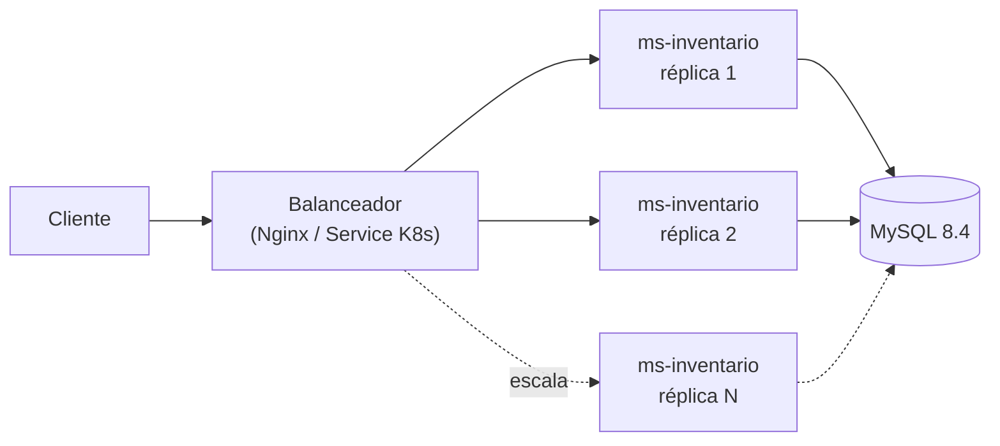
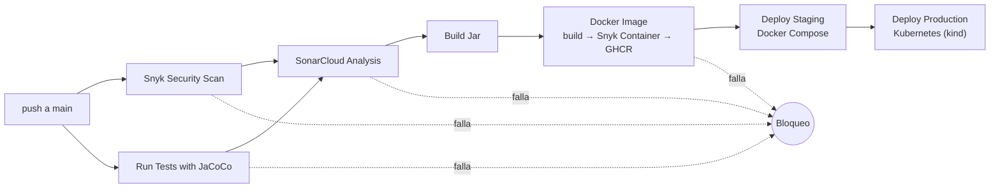
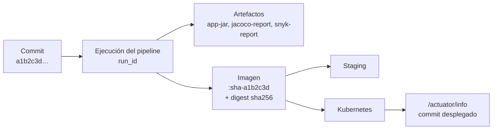

# ms-inventario · Pipeline CI/CD


**Asignatura:** DOY0101 – Ingeniería DevOps · **Evaluación Parcial N°2**
**Integrantes:** _Nombre Apellido 1_ · _Nombre Apellido 2_

> Reemplaza `OWNER/REPO` en el badge por tu usuario y nombre de repositorio.

Microservicio REST de inventario de productos (Java 21 + Spring Boot 4 + MySQL) con un pipeline CI/CD completo en GitHub Actions: pruebas automatizadas con JaCoCo, análisis de seguridad con Snyk y SonarCloud con bloqueo, imagen Docker multi-stage, despliegue automático en un entorno simulado y orquestación con Docker Compose y Kubernetes.

---

## Índice

1. [Arquitectura](#1-arquitectura)
2. [Estructura del repositorio](#2-estructura-del-repositorio)
3. [Ejecución local](#3-ejecución-local)
4. [API del microservicio](#4-api-del-microservicio)
5. [Pipeline CI/CD](#5-pipeline-cicd)
6. [Seguridad: alertas y bloqueos](#6-seguridad-alertas-y-bloqueos)
7. [Contenedores, escalabilidad y orquestación](#7-contenedores-escalabilidad-y-orquestación)
8. [Cómo se garantiza la trazabilidad](#8-cómo-se-garantiza-la-trazabilidad)
9. [Cómo se garantiza la calidad](#9-cómo-se-garantiza-la-calidad)
10. [Relación con los contenidos del curso](#10-relación-con-los-contenidos-del-curso)
11. [Configuración inicial del repositorio](#11-configuración-inicial-del-repositorio)
12. [Declaración de uso de IA](#12-declaración-de-uso-de-ia)
13. [Conclusiones y reflexiones individuales](#13-conclusiones-y-reflexiones-individuales)

---

## 1. Arquitectura



| Componente | Tecnología |
|---|---|
| Microservicio | Java 21, Spring Boot 4 (Web MVC, Data JPA, Validation, Actuator), Maven Wrapper |
| Base de datos | MySQL 8.4 (H2 en memoria para desarrollo y pruebas) |
| Pruebas | JUnit, Mockito, Spring MockMvc, JaCoCo 0.8.13 |
| Contenedores | Docker multi-stage (dependencias → test → compile → prod) |
| Orquestación | Docker Compose (staging) y Kubernetes con kind (producción simulada) |
| CI/CD | GitHub Actions + GitHub Container Registry (GHCR) |
| Seguridad y calidad | Snyk (Open Source, Code, Container), SonarCloud, Dependabot, Dependency Review |

## 2. Estructura del repositorio

```
.
├── .github/
│   ├── dependabot.yml            # Actualizaciones automáticas de dependencias
│   └── workflows/ci-cd.yml       # Pipeline CI/CD
├── .mvn/wrapper/ , mvnw, mvnw.cmd  # Maven Wrapper (no requiere Maven instalado)
├── src/main/java/...             # Código del microservicio
├── src/test/java/...             # Pruebas unitarias y de integración
├── k8s/                          # Manifiestos Kubernetes (Kustomize)
├── nginx/nginx.conf              # Balanceador para Docker Compose
├── scripts/smoke-test.sh         # Prueba de humo post-despliegue
├── Dockerfile                    # Imagen multi-stage
├── docker-compose.yml            # Orquestación del entorno staging
└── pom.xml
```

## 3. Ejecución local

**Requisitos:** Java 21 y Docker con Compose v2. No se necesita Maven instalado: se usa el Maven Wrapper (`mvnw` en Linux/Mac, `mvnw.cmd` en Windows).

```bash
# Ejecutar las pruebas (genera también el reporte JaCoCo)
./mvnw clean test            # Windows: mvnw clean test

# Abrir el reporte de cobertura
cd target/site/jacoco        # Windows: cd target\site\jacoco
open index.html              # Windows: start index.html

# Pruebas + verificación de cobertura mínima (lo mismo que hace el pipeline)
./mvnw clean verify

# Ejecutar solo la aplicación (usa H2 en memoria)
./mvnw spring-boot:run

# Levantar el stack completo: MySQL + 2 réplicas Java + Nginx
docker compose up -d --build
bash scripts/smoke-test.sh http://localhost:8080

# Escalar a 4 réplicas
docker compose up -d --scale java=4

# Bajar todo
docker compose down -v
```

Kubernetes en local (opcional, requiere [kind](https://kind.sigs.k8s.io/)):

```bash
kind create cluster --name inventario
docker build -t ms-inventario:local .
kind load docker-image ms-inventario:local --name inventario
kubectl apply -k k8s
kubectl -n inventario rollout status deployment/ms-inventario
kubectl -n inventario port-forward svc/ms-inventario 8081:80
```

## 4. API del microservicio

Base: `/api/v1/productos`

| Método | Ruta | Descripción | Respuestas |
|---|---|---|---|
| GET | `/` | Lista productos | 200 |
| GET | `/{id}` | Obtiene un producto | 200, 404 |
| POST | `/` | Crea un producto | 201, 400, 409 (SKU duplicado) |
| PUT | `/{id}` | Actualiza un producto | 200, 400, 404, 409 |
| PATCH | `/{id}/stock` | Ajusta stock (`{"cantidad": -3}`) | 200, 404, 409 (stock insuficiente) |
| DELETE | `/{id}` | Elimina un producto | 204, 404 |

Endpoints operativos (Actuator): `/actuator/health`, `/actuator/health/liveness`, `/actuator/health/readiness`, `/actuator/info`, `/actuator/prometheus`.

Ejemplo:

```bash
curl -X POST http://localhost:8080/api/v1/productos \
  -H 'Content-Type: application/json' \
  -d '{"sku":"FA-001","nombre":"Filtro de aceite","precio":4990,"stock":10}'
```

## 5. Pipeline CI/CD

Archivo: [`.github/workflows/ci-cd.yml`](.github/workflows/ci-cd.yml). Se ejecuta en cada `push` a `main`, en cada Pull Request hacia `main` y manualmente (`workflow_dispatch`).



| Job | Qué hace | Bloquea si… | Artefacto | Indicador |
|---|---|---|---|---|
| **Snyk Security Scan** | Snyk Open Source (dependencias, SCA) y Snyk Code (código, SAST); sube hallazgos a *Security → Code scanning*; `snyk monitor` en `main` | Hay vulnerabilidades de severidad alta o crítica | `snyk-report` | IE3 |
| **Run Tests with JaCoCo** | `mvnw clean verify`: pruebas unitarias y de integración, reporte de cobertura y verificación del mínimo | Falla una prueba o la cobertura de líneas es < 70 % | `jacoco-report`, `test-reports` | IE2 |
| **Dependency Review** (solo PR) | Revisa las dependencias que agrega el PR | Se agrega una dependencia con vulnerabilidad alta/crítica | – | IE3 |
| **SonarCloud Analysis** | Análisis de calidad (bugs, *code smells*, cobertura, duplicación) esperando el *Quality Gate* | El Quality Gate de SonarCloud falla | – | IE2, IE3 |
| **Build Jar** | `mvnw clean package -DskipTests` | Falla la compilación | `app-jar` | IE4 |
| **Docker Image** | Build multi-stage (vuelve a correr las pruebas dentro), Snyk Container, publicación en GHCR, atestación de procedencia | La imagen tiene vulnerabilidades altas/críticas | `snyk-container-report` | IE1, IE3 |
| **Deploy Staging** | Despliega MySQL + 2 réplicas + Nginx con Docker Compose usando la imagen por *digest*; prueba de humo y escalado a 3 réplicas | Falla el despliegue, la prueba de humo o el escalado | – | IE4, IE5 |
| **Deploy Production** | Clúster Kubernetes con kind, despliegue con Kustomize (HPA, PDB, NetworkPolicy), *rollout* y prueba de humo | Falla el *rollout* o la prueba de humo | `manifiesto-k8s` | IE4, IE5 |

En los Pull Requests se ejecutan las etapas de validación (pruebas, seguridad, calidad e imagen) sin publicar ni desplegar; el despliegue ocurre solo al llegar a `main`.

## 6. Seguridad: alertas y bloqueos

**Bloqueos (el pipeline se detiene):**

- **Snyk** se ejecuta con `--severity-threshold=high`. Si encuentra algo alto o crítico, el job falla y, como el resto depende de él (`needs`), no se construye ni se despliega nada. Los reportes se guardan igual (`if: always()`) para poder revisarlos.
- **SonarCloud** espera el resultado del *Quality Gate* (`sonar.qualitygate.wait=true`); si no se cumple, el pipeline se detiene.
- **Snyk Container** analiza la imagen final; si falla, la imagen no se publica.
- **Dependency Review** en PR impide introducir dependencias vulnerables.
- **Protección de la rama `main`** (ver sección 11): los checks del pipeline son obligatorios para fusionar un PR.

**Alertas (se notifica al equipo):**

- Hallazgos de Snyk en formato SARIF en **Security → Code scanning** del repositorio.
- **Dependabot alerts** y PR automáticos de actualización (Maven, imagen Docker y GitHub Actions) cada lunes.
- **`snyk monitor`** registra el proyecto en Snyk, que envía correos cuando aparece una nueva vulnerabilidad aunque no haya commits nuevos.
- Notificaciones de GitHub por correo cuando un *workflow* falla.

**Endurecimiento de los contenedores:**

| Medida | Dónde |
|---|---|
| Usuario no root (UID 10001) | `Dockerfile`, `deployment.yaml` |
| Sistema de archivos de solo lectura (`/tmp` como volumen temporal) | `docker-compose.yml`, `deployment.yaml` |
| Sin escalamiento de privilegios y sin *capabilities* de Linux | `docker-compose.yml` (`no-new-privileges`), `deployment.yaml` |
| Perfil seccomp `RuntimeDefault` y Pod Security Admission `restricted` | `deployment.yaml`, `mysql.yaml`, `namespace.yaml` |
| Base de datos sin puertos expuestos, en red interna / NetworkPolicy | `docker-compose.yml`, `networkpolicy.yaml` |
| Credenciales en variables de entorno y Secrets (no en el código) | `secret.yaml`, GitHub Secrets |
| Permisos mínimos del `GITHUB_TOKEN` por job | `ci-cd.yml` |

## 7. Contenedores, escalabilidad y orquestación

**Imagen Docker** ([`Dockerfile`](Dockerfile)), en cuatro etapas:

| Etapa | Imagen base | Qué hace |
|---|---|---|
| `dependencies` | `eclipse-temurin:21-jdk` | Copia solo `pom.xml` y el wrapper y ejecuta `dependency:go-offline`. Mientras no cambie el `pom.xml`, Docker reutiliza esta capa y no vuelve a descargar dependencias. |
| `test` | `eclipse-temurin:21-jdk` | Reutiliza el caché `.m2` y ejecuta `mvnw test`. Si una prueba falla, la imagen no se construye. |
| `compile` | `eclipse-temurin:21-jdk` | Copia `/app` desde `test` (eso crea la dependencia entre etapas), empaqueta el jar y lo separa en capas. |
| `prod` | `eclipse-temurin:21-jre-alpine` | Solo JRE + jar. Usuario sin privilegios, `HEALTHCHECK`, `MaxRAMPercentage=75` y `ExitOnOutOfMemoryError`. |

**Docker Compose (staging):** MySQL con volumen y *healthcheck*, **2 réplicas** del servicio `java` con límites y reservas de CPU/memoria, Nginx como balanceador y arranque ordenado con `depends_on: condition: service_healthy` (espera a que MySQL esté listo, no solo iniciado). El pipeline demuestra el escalado horizontal subiendo a 3 réplicas.

**Kubernetes (producción simulada):**

| Recurso | Propósito |
|---|---|
| `Deployment` (2 réplicas, `RollingUpdate` con `maxUnavailable: 0`) | Despliegues sin caída del servicio |
| `requests` / `limits` de CPU y memoria | Asignación predecible de recursos |
| `startupProbe`, `livenessProbe`, `readinessProbe` (Actuator) | Solo recibe tráfico un pod listo; los pods colgados se reinician |
| `HorizontalPodAutoscaler` (2–6 réplicas, CPU 70 %) | Escalado automático según carga |
| `PodDisruptionBudget` | Siempre queda al menos 1 réplica disponible |
| `topologySpreadConstraints` | Reparte réplicas entre nodos |
| `StatefulSet` + `PersistentVolumeClaim` | MySQL con almacenamiento persistente |
| `ConfigMap` / `Secret` | Configuración separada del código |
| `NetworkPolicy` | Solo el microservicio puede conectarse a la base de datos |
| Apagado *graceful* + `preStop` | No se cortan solicitudes en curso al reemplazar pods |

## 8. Cómo se garantiza la trazabilidad

Desde el commit hasta el contenedor en ejecución se puede seguir el mismo identificador:



1. **Etiquetas inmutables**: cada imagen se etiqueta con `sha-<commit>` además de `main` y `latest`.
2. **Despliegue por digest**: staging y producción usan `imagen@sha256:…`, es decir, exactamente la imagen que pasó los escaneos.
3. **Metadatos OCI** en la imagen (`org.opencontainers.image.revision`, `source`, `created`).
4. **Atestación de procedencia** (SLSA) firmada que vincula la imagen con el workflow y el commit que la generó.
5. **La aplicación informa su versión**: `/actuator/info` devuelve el commit, la ejecución del pipeline y el entorno; la prueba de humo **verifica** que el commit desplegado sea el esperado.
6. **Historial de Kubernetes**: cada despliegue queda anotado con `kubernetes.io/change-cause` (commit, run e imagen), visible con `kubectl rollout history`.
7. **Artefactos por ejecución**: `app-jar`, `jacoco-report`, `test-reports`, `snyk-report`, `snyk-container-report` y `manifiesto-k8s`, descargables desde la ejecución en la pestaña Actions.
8. **Environments de GitHub** (`staging` y `production`): historial de qué versión se desplegó en cada entorno y cuándo.

## 9. Cómo se garantiza la calidad

- **Pruebas en tres niveles**: unitarias del servicio (Mockito), del contrato HTTP del controlador (MockMvc) y de integración con el contexto completo de Spring y base de datos H2.
- **Casos críticos cubiertos**: SKU duplicado, stock que quedaría negativo, recursos inexistentes y validación de datos de entrada.
- **Política de cobertura**: JaCoCo exige al menos **70 % de líneas cubiertas** (regla `check` en el `pom.xml`); si baja, `mvnw verify` falla y el pipeline se detiene.
- **SonarCloud**: Quality Gate sobre bugs, vulnerabilidades, *code smells*, duplicación y cobertura del código nuevo.
- **Las pruebas corren dos veces**: en el job de CI y dentro del build de Docker, así una imagen nunca se construye con pruebas fallidas.
- **Pruebas de humo post-despliegue** en ambos entornos con un flujo CRUD real.
- **Revisión obligatoria por PR** con los checks del pipeline como requisito para fusionar.

## 10. Relación con los contenidos del curso

| Clase | Contenido | Dónde se aplica | Qué se agregó |
|---|---|---|---|
| 2.1.1 Docker multi-stage | Etapas `dependencies` → `test` → `compile` → `prod`, caché de dependencias con `go-offline`, `COPY --from` | `Dockerfile` | Imagen final solo con JRE Alpine, jar en capas, usuario no root, `HEALTHCHECK`, metadatos OCI |
| 2.2.1 Docker Compose | Servicios, `depends_on` con `condition: service_healthy`, healthcheck con `mysqladmin ping`, límites y reservas de recursos | `docker-compose.yml` | Réplicas + balanceador Nginx, red interna para la BD, solo lectura, `no-new-privileges` |
| 2.3.1 Pruebas y JaCoCo | Plugin `jacoco-maven-plugin` 0.8.13 con `prepare-agent` y `report` en fase `test`; job de pruebas y artefacto `jacoco-report` | `pom.xml`, job *Run Tests with JaCoCo* | Regla `check` de cobertura mínima como bloqueo, resumen de cobertura y resultados de pruebas en la ejecución |
| 2.4.1 Seguridad en el pipeline | Snyk CLI (`npm install -g snyk`, `snyk auth`, `--severity-threshold=high`, reporte JSON), SonarCloud con `SONAR_TOKEN`, cadena de jobs con `needs`, artefactos `app-jar`/`jacoco-report`/`snyk-report` | Jobs *Snyk Security Scan*, *SonarCloud Analysis*, *Build Jar* | Snyk Code (SAST) y Snyk Container, hallazgos en la pestaña Security, Quality Gate de Sonar con espera, Dependabot y Dependency Review |

Dos detalles respecto a los ejemplos de las clases:
- En la clase de Compose el ejemplo de límites dice `resource:`; la clave correcta es **`resources:`** (con `resource:` Compose rechaza el archivo).
- En SonarCloud, el parámetro `-Dsonar.login` está obsoleto; se usa **`-Dsonar.token`**.

## 11. Configuración inicial del repositorio

1. **Crear el repositorio** (público recomendado: Code scanning, Dependency Review y atestaciones son gratuitos en repos públicos) y subir el código a `main`.
2. **Snyk**:
   - Crear una cuenta en [snyk.io](https://snyk.io) y copiar el token desde [app.snyk.io/account](https://app.snyk.io/account).
   - En GitHub: *Settings → Secrets and variables → Actions → New repository secret* → `SNYK_TOKEN`.
   - Repetir en *Settings → Secrets and variables → Dependabot* (para que los PR de Dependabot también pasen el análisis).
   - En Snyk: *Settings → Snyk Code* → activar **Snyk Code**.
3. **SonarCloud** (opcional, si no se configura el job se omite con una advertencia):
   - Ingresar a [sonarcloud.io](https://sonarcloud.io) con GitHub e importar el repositorio.
   - En el proyecto: *Administration → Analysis Method* → **desactivar Automatic Analysis** (se analiza desde el pipeline).
   - Generar un token en [sonarcloud.io/account/security](https://sonarcloud.io/account/security/) y guardarlo como secreto `SONAR_TOKEN`.
   - Si la clave del proyecto u organización no es `<usuario>_<repo>` / `<usuario>`, definir las variables `SONAR_PROJECT_KEY` y `SONAR_ORGANIZATION` en *Settings → Secrets and variables → Actions → Variables*.
4. **Dependabot**: *Settings → Code security* → activar **Dependency graph**, **Dependabot alerts** y **Dependabot security updates**.
5. **Permisos del workflow**: *Settings → Actions → General → Workflow permissions* → *Read and write permissions* (para publicar en GHCR).
6. **Protección de `main`**: *Settings → Rules → Rulesets → New branch ruleset* sobre `main`:
   - *Require a pull request before merging*.
   - *Require status checks to pass*: `Snyk Security Scan`, `Run Tests with JaCoCo`, `SonarCloud Analysis`, `Build Jar`, `Docker Image (build, scan, push)`, `Dependency Review`.
7. **(Opcional) Aprobación manual a producción**: *Settings → Environments → production → Required reviewers*.
8. **(Opcional) Secretos de base de datos**: `STAGING_DB_PASSWORD`, `STAGING_DB_ROOT_PASSWORD`, `K8S_DB_PASSWORD`, `K8S_DB_ROOT_PASSWORD`. Si no se definen, se usan las credenciales de desarrollo.

## 12. Declaración de uso de IA

> Completar por el equipo según las [indicaciones de Bibliotecas Duoc UC](https://bibliotecas.duoc.cl/ia).

| Herramienta | Para qué se usó | Cómo se revisó/validó |
|---|---|---|
| _Ej.: Claude (Anthropic)_ | _Describir qué partes apoyó_ | _Describir cómo lo revisaron, probaron y ajustaron_ |

Referencia (APA 7):
_Anthropic. (2026). Claude (versión Opus 5.5) [Modelo de lenguaje de gran tamaño]. https://claude.ai_

## 13. Conclusiones y reflexiones individuales

> Según las instrucciones de la evaluación, esta sección debe ser redactada por el equipo **sin apoyo de IA**.

### Conclusiones del equipo

_Pendiente._

### Reflexión individual – Integrante 1

_Pendiente: aprendizaje y contribución al proyecto._

### Reflexión individual – Integrante 2

_Pendiente: aprendizaje y contribución al proyecto._
